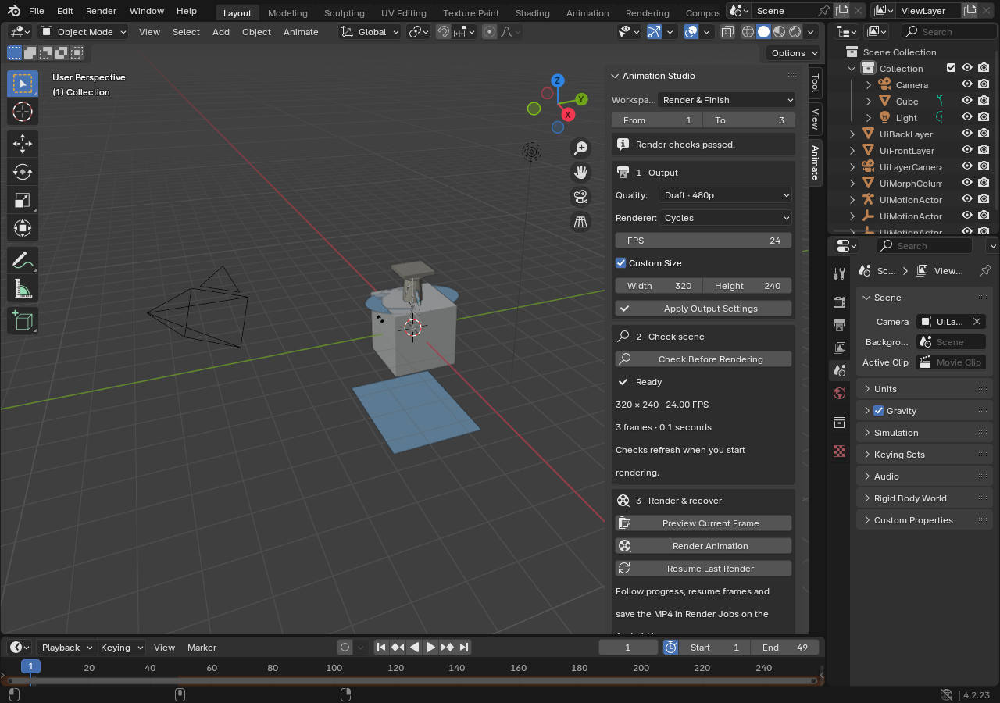

# Animation Studio 0.60

Animation Studio extends the existing Creator Studio and full native Blender
engine with guided layers, character motion, shape animation, timing and output
checks. Open **Animation Studio** on the Android home screen, or **Animate** in
the native Blender sidebar. Existing Creator, sculpt, materials, physics, asset,
storage and authenticated ChatGPT tools remain available.



This capture is the real desktop verification window, not an Android screenshot.

## Workflows

| Area | Native editable result |
| --- | --- |
| 2D | Rectangle, ellipse and validated polygon color layers with mesh outlines, UVs and emission materials |
| 2.5D | Perspective camera movement across layers at different depths; existing layer animation is preserved |
| Character | Articulated mannequin with weighted parts, leg IK targets and knee controls |
| Movement | Editable walk, idle and squat presets for the starter; evaluated contact, joint-flexion and discontinuity checks |
| Morph / time | Breathe, twist and wave shape keys with animation; a private mesh copy preserves the original geometry |
| Keyframes | Inspect action keys, then retime with a revision token; Bezier handles follow the time transform |
| Finish | Explicit draft/standard/final output settings, camera/asset/timeline preflight, frame preview and recoverable animation queue |

“4D” here means a 3D shape changing over time. It does not mean a four-spatial-
dimension renderer. These workflows use Blender data, not embedded proprietary
Maya, ZBrush, Houdini, Toon Boom or compositing applications. There is no measured
fivefold speed or quality guarantee.

### Layers and parallax

Create two or more layers with different Depth values. Select those meshes,
choose camera travel and frame range, and create the parallax camera. The camera
looks down the Z axis toward XY layers. Camera distance must remain in front of
the source geometry. The tool samples bounds at the start, middle and end; it
does not certify every intermediate camera/object intersection. Existing drawing,
asset import and Blender mesh tools can further edit the scene.

### Character motion

Create a uniquely named mannequin, select its rig or body, then create a walk,
idle or squat clip. Run **Check Movement** before rendering. The audit samples
actual evaluated world-space bones, including IK, and reports contact drift,
declared joint flexion and abrupt movement. Custom rigs can use the same typed
audit with explicit bone mappings and contact intervals.

The starter is an articulated posing mannequin with rigidly weighted components.
It is not a finished anatomical character, a continuous skin generator, or an
automatic rig for arbitrary imported bodies. Existing rig and sculpt tools are
available for those artist workflows. Audit results cover the declared mappings,
sampled frames and thresholds; they cannot prove universal physical correctness,
collision-free motion or visual appeal. Individual retiming of Motion Lab clip actions is blocked because the rig,
IK-target actions and contact windows must stay synchronized. Use Blender
controls to coordinate advanced edits, then inspect the movement again.

### Shape animation and timing

Select a mesh with enough interior geometry for the desired deformation, then
create a named morph. The tool refuses existing shape keys and degenerate
deformations, and preserves transform actions and shared source geometry.

For timing, inspect the chosen action before applying scale, offset and pivot:

`new_frame = pivot + (old_frame - pivot) * scale + offset`

The revision token prevents stale edits. Shared actions require explicit API
consent; NLA-used or unsupported actions are rejected instead of silently changing
strip timing or modifier behavior. Use Blender's native NLA and Graph Editor for
more complex edits.

### Rendering

Choose output quality, dimensions, frame rate and range in **Finish**, then apply
the settings and check the scene. The selected saved render profile is updated
along with the visible settings, so the existing queue uses the chosen output.
Preflight explains missing cameras, incompatible settings and unpacked or missing
images. Asset checking is bounded and does not validate simulation caches or
decode every external movie/tile/sequence frame.

**Preview Current Frame** and **Render Animation** hand off to the existing
Android foreground render queue. A queued receipt is not a finished video. Use
Render Jobs to inspect progress, pause/resume and export. Thermal behavior and
Android background limits still apply; no silent quality downgrade is introduced.

## ChatGPT / native API

All operations use the existing authenticated `production.execute` envelope,
actual Render public target ID, native main-thread dispatch and durable plan
queue. Discover complete input schemas with `studio.tool.search`:

```text
studio.animation.catalog          studio.animation.layer.create
studio.animation.parallax.create  studio.animation.morph.create
studio.motion.rig.create          studio.motion.clip.create
studio.motion.audit               studio.keyframes.inspect
studio.keyframes.retime           studio.finish.inspect
studio.finish.preset
```

Malformed payloads are rejected before checkpoints. Mutations save a recoverable
`.blend` checkpoint, refuse frozen render snapshots and roll back their own partial
changes on failure. A queued plan remains bound to the scene and native session
that accepted it. There are no new arbitrary-code, shell or network inputs.

## Build and verification

Package `com.rezox.render`, Android 12+ ARM64, version code **61**, version name
**0.60.0-animation-studio**. The original native engine and historical signing
certificate are retained. No project migration, uninstall or data clearing is
performed by this source upgrade.

The consolidated `render-060-animation-suite.yml` workflow runs payload and
preservation tests, real Blender 4.2.23/5.2.3 semantic tests, visible Blender UI
operators, Android unit tests, the signed full native APK build and instrumentation
compilation. Packaging verification compares every embedded runtime module with
the tested source and checks the engine, package, version and signer. Its release
contains the APK, checksum and machine-readable evidence.

Desktop tests and build verification do not establish physical phone touch/GPU
behavior, installation compatibility, long render endurance or final artistic
quality. Check the actual workflow result for the exact commit being installed.
