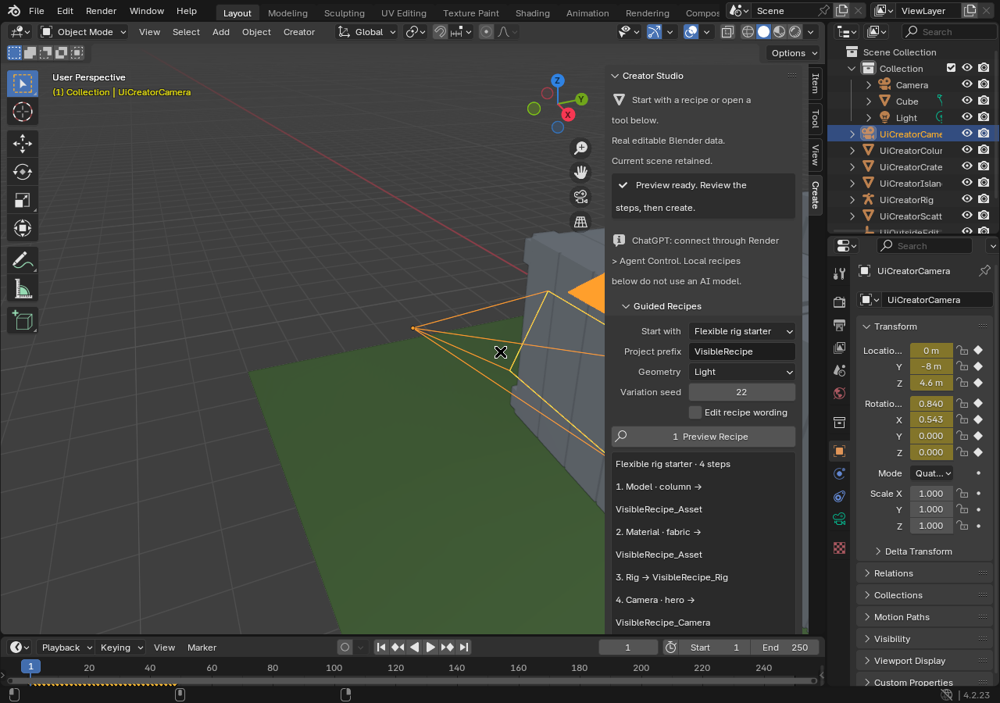

# Creator Studio 0.50

Creator Studio adds guided, editable workflows to the existing on-device Blender
engine. All meshes, material nodes, Geometry Nodes, armatures, camera transforms
and animation keys are native Blender data saved in normal `.blend` projects.

## Start creating

1. Open **Creator workspace** on the Android home screen. Inside Blender, the
   floating Render controls also offer **Creator · models, worlds & motion**.
2. In the **Create** sidebar, choose a recipe or a direct tool. Existing objects
   remain in the scene; use a new name for each asset or recipe.
3. For recipes, choose a quality preset and seed, select **Preview**, inspect the
   steps, then **Apply**. The preview performs no scene edits. Changing the form
   or relevant scene/queue state invalidates the preview.
4. Watch the native plan status. Pause before the next step or cancel pending
   work. Completed steps have real receipts; queue acceptance is not completion.
5. Use the existing Save Session, `.blend` export, render and project tools to
   preserve or deliver the result. Full Blender remains available for manual work.



The capture above is the actual desktop Blender verification window, not an Android phone screenshot.

## New native tools

| Area | Delivered behavior |
| --- | --- |
| Props | Crate, barrel, column, arch, stairs, table, rock and tree; size, detail and deterministic seed |
| Worlds | Island, mountain, dune and plain heightfields; editable UV-mapped mesh; configurable size and resolution |
| Scattering | Seeded linked Geometry Nodes instances with scale variation and optional terrain placement |
| Materials | Editable procedural wood, metal, stone, fabric, ceramic and emissive shaders |
| Motion | Real turntable, float, bounce and orbit keyframes with an optional cycle modifier |
| Cameras | Hero, orbit, top and close-up shots aimed at actual target bounds |
| Rigs | A weighted deform-chain rig for flexible props; existing humanoid and IK tools remain separate |

Terrain spans up to 2,048 Blender units with a maximum resolution of 128.
Scatter requests are bounded at 10,000 instances, with a conservative evaluated
source-triangle budget of 2,000,000. The runtime rejects excessive work instead
of silently lowering requested quality. These are admission limits, not a
guarantee that every phone can smoothly display the maximum. Map streaming,
unlimited worlds and automatic production-quality character modeling are not
implemented by these presets.

## Commands and ChatGPT

The existing authenticated `production.execute` envelope and Render target ID
remain unchanged. Discover schemas from `studio.tool.search`,
`studio.create.catalog` and `studio.command.catalog` in the running app. New
operation names are:

```text
studio.create.catalog     studio.create.model      studio.create.terrain
studio.create.scatter     studio.create.material   studio.create.motion
studio.create.camera      studio.create.rig
studio.command.catalog    studio.command.preview   studio.command.submit
```

The offline recipe compiler accepts documented phrases, including:

```text
wooden crate asset
product scene with ceramic barrel
forest environment
island environment
mountain environment
dunes environment
plains environment
animated metal barrel bounce
studio turntable with wooden crate
flexible rig starter
```

Its full grammar, aliases and examples are returned by `studio.command.catalog`.
Unrecognized briefs are rejected with examples; their words are never treated
as Python, shell commands, asset URLs or an instruction to download data.
The UI labels this as offline recipe planning. There is no API key embedded in
the APK, and no paid inference service is required for local tools.

Example authenticated payload after obtaining the actual Render target ID:

```json
{
  "operation": "studio.command.preview",
  "target_id": "<actual Render public ID>",
  "payload": {
    "brief": "forest environment",
    "name": "ForestStudy",
    "seed": 42,
    "quality": "standard"
  }
}
```

Submit the same request using `studio.command.submit` and the returned
`preview_sha256`. The digest binds the normalized request, generated steps and
relevant scene/queue state. Exact retries return the original plan. Inspect
`studio.plan.status` for completion. ChatGPT can also build custom multi-step
plans from supported existing sculpting, rigging, UV/material, reference,
animation and camera operations without using the brief grammar.

The phone must run the native editor and an authorized agent session to execute
commands. The existing standalone Render relay and VideoStudio compatibility
transport remain available; an online relay alone is not proof of execution.
No arbitrary remote Python or shell execution is added.

## Recovery and data protection

- Direct Creator edits and recipe steps save a `.blend` checkpoint first.
- Failed Creator operations roll back the datablocks and explicit edits they
  created. The checkpoint remains available for broader recovery.
- A plan binds to the real scene in the native session that accepted it. Scene
  switches, project reopenings or a native-process restart stop it for review
  before another edit. Old unbound plans also require inspection and resubmission.
- Interrupted writes are never automatically replayed. Cancellation does not
  undo already completed steps.
- Automated `.blend` recovery disables script auto-execution. Local scripting
  remains an explicit Blender workflow for trusted code.
- Existing application identity, saved projects and signing identity are
  preserved. The build process never uninstalls the app or clears its data.

## Build and evidence

The candidate targets Android 12+ ARM64, package `com.rezox.render`, version code
60, version `0.50.0-creator-studio`. It uses the existing historical development
certificate; an in-place install requires the installed app's certificate to
match. Permanent owner release signing remains a separate protected workflow.

`.github/workflows/render-050-creator-suite.yml` runs contract, recovery, security,
real desktop Blender and Android unit tests. It builds the full native APK,
compiles instrumentation, verifies certificate/manifest/native libraries and
compares every embedded Render Python module with the exact tested commit.
The APK, SHA-256 checksum and machine-readable verification report are published
as a development prerelease. It is not the smaller foundation-only APK.

Desktop Blender tests establish native data semantics. They do not establish
phone GPU compatibility, touch ergonomics, thermal endurance or an installed
device's certificate. The original pinned Android Blender binary is retained;
the upgrade extends its tools and workflows rather than replacing its core
renderer or claiming an unmeasured fivefold improvement over official Blender.
